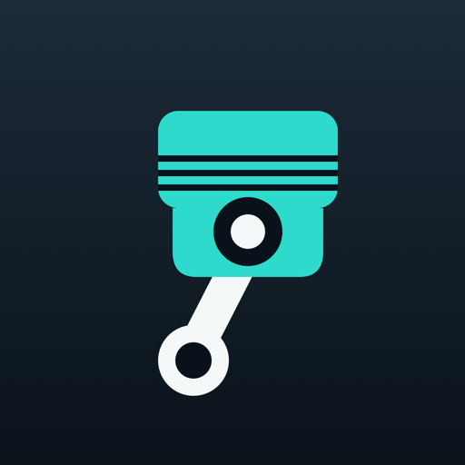

# OBDLogger

**An ELM327 OBD-II logger for iOS and macOS that also reads manufacturer-specific data.**
Compatible OBD-II vehicles can use the standard live data and fault codes the adapter
supports. A vehicle profile adds the data the manufacturer keeps behind a proprietary
service — starting with DPF soot and regeneration state on a 2016 Mitsubishi Outlander
diesel.



[](https://github.com/NaleenB/obd-profile-logger/actions/workflows/ci.yml)
[]()
[]()
[](LICENSE)
[]()

---

## Generic first, vehicle-specific where it counts

Most OBD apps stop at the standard PID list. On this Outlander that is 26 values and
nothing about the diesel particulate filter — the single most expensive thing to get
wrong on a modern diesel.

This project does both:

| Layer | Coverage | How |
|---|---|---|
| **Standard OBD-II** | Any car with a compliant ELM327 adapter | Modes `01`, `03`, `07`, `0A`, `09` |
| **Vehicle profile** | Per vehicle, loaded from JSON | Manufacturer service, byte offsets, scaling |
| **Included profile** | 2016 Outlander 2.2 DiD (4N14) | Mitsubishi service `0x21` — 273 parameters |

Verified on the car, not inferred:

```
Soot by accumulation        2.6 g/L   (trigger 9.3 g/L, 310 km since regeneration)
Distance since regeneration  310 km
Regeneration count           123
Short-interval regens          0      <- DPF is healthy
```

Also recovered from the same profile: EGT sensors, EGR position and target, VGT duty
before/after compensation, injector small-injection learning across four cylinders and
five rail pressures, oil dilution, and rail pressure versus target.

## Supported vehicles

| Vehicle | Standard OBD | Manufacturer data | Verified |
|---|---|---|---|
| Mitsubishi Outlander 2016, 2.2 DiD (4N14) | yes | yes — 273 parameters | on car |
| Generic ISO 15765-4 (CAN) — template | yes | none | not yet |
| Anything else | depends on protocol and module headers | needs a profile | — |

Adding a vehicle is a JSON profile plus registering its bundled resource; decoding,
polling and presentation stay generic. See [`profiles/README.md`](profiles/README.md).

### Unverified: which other Mitsubishis might work

Only the 2016 Outlander 2.2 DiD is actually tested. Everything below is inference,
not measurement — treat it as a starting point for a contribution, not a
compatibility promise.

| Likelihood | Models | Reasoning |
|---|---|---|
| **Most likely** | 4N1-family diesels: ASX 1.8 DiD (4N13), Triton/L200 and Pajero Sport 2.4 DiD (4N15) | Same engine architecture, so the manufacturer service is probably present. The **byte offsets will not be identical.** |
| **Plausible** | Mitsubishi diesels roughly 2008–2020 supported by MUT-III era diagnostics | The protocol is likely there; the layout almost certainly is not. |
| **Unlikely to help** | Anything pre-CAN (before ~2008), and the 3.2 DiD Pajero | Earlier generation of diagnostic protocol. |

**Answering the service is not proof the offsets apply.** Even inside the MUT-III
database used to decode this car, five diesel ECU variants exist and the DPF block
sits on local identifier `0x11` in some and `0x4C` in others. The app therefore
requires a calibration-ID, VIN or live-data match before applying a manufacturer
profile, and falls back to generic OBD when it cannot prove the match.

To find out what an unknown car exposes, no app is needed:

```bash
cd Probe && ./run.sh --sweep-only --service 21
```

Two minutes, read-only. Any identifier that answers is a candidate for a profile.

The app identifies the car itself and never asks. Three routes, in order of
strength:

1. **Calibration ID match** (mode 09 PID 04) — the sharpest test, since byte layouts
   follow the ECU software version.
2. **VIN prefix match**, when the calibration ID cannot be read. The longest
   matching prefix wins.
3. **Live-data agreement** — decode "engine speed" from the manufacturer block and
   check it against the ECU's own rpm over standard OBD. It has to agree three
   probes running; a wrong layout produces a byte that cannot track it.

There is no profile picker. Until the car proves which profile applies — often a
few seconds after the ECU wakes — the app runs on standard OBD only and says so.
Manufacturer data appears when identification succeeds, never before. Answering
`0x21` is never treated as proof that the offsets apply: several models speak it
with completely different block layouts, and a wrong match would produce confident
nonsense.

## Quick start

Requires Xcode 16+ and an ELM327 adapter (BLE for iPhone; BLE or USB for Mac).

```bash
git clone https://github.com/NaleenB/obd-profile-logger.git
cd obd-profile-logger

# Discover what your car exposes — no app needed
cd Probe && ./run.sh

# Or run the app — builds and launches, no Xcode UI needed
cd ../App && ./run.sh

# Install on a connected iPhone, bumping the version first
cd .. && ./tools/deploy-ios.sh
```

The probe is the fastest way to find out whether a vehicle supports a manufacturer
service at all: `./run.sh --sweep-only --service 21`.

## What it does

- **Live data** over BLE, with a profile-driven manufacturer panel
- **Automatic vehicle identification** from calibration ID, VIN or live-data agreement, with no profile picker
- **Automatic recording** on connect, to append-only NDJSON: one line per successful
  observation, each with its own monotonic timestamp, plus a manifest and events
- **DTC scanning** with per-module attribution, distinguishing "no codes" from
  "did not answer"
- **Battery test** across every start: cranking minimum, recovery time, charging voltage
- **Idle disconnect** after ten minutes without data, so a parked session closes itself
- **ZIP export** through the system share sheet

## Design principles

- **Read-only.** No writes, no actuator tests, no forced regenerations. A wrong write
  can damage a vehicle.
- **Honest provenance.** Every finding says whether its limit came from a factory manual
  or a heuristic. An inference never masquerades as a specification.
- **Absence is data.** A failed read writes nothing — no zeros, no carry-forward.
- **Frames stay separate.** Several modules answer one OBD request; merging their
  replies invents faults.

## Repository layout

```
profiles/   per-vehicle JSON — the extension point
Core/       OBDCore: models, health rules, decoders, recorder (no I/O beyond files)
Link/       OBDLink: BLE transport and ELM327 client
App/        SwiftUI app for iOS and macOS
Probe/      macOS CLI for discovery and capture
tools/      offline generators
docs/       architecture, protocol notes, session format
Research/   how the manufacturer data was obtained
```

## Documentation

- [`docs/architecture.md`](docs/architecture.md) — how the pieces fit
- [`docs/protocol-notes.md`](docs/protocol-notes.md) — ELM327 and Mitsubishi quirks, written for any language
- [`docs/session-format.md`](docs/session-format.md) — the on-disk contract
- [`docs/first-drive-checklist.md`](docs/first-drive-checklist.md) — hardware verification
- [`docs/install-ios.md`](docs/install-ios.md) — installing on an iPhone with free provisioning
- [`profiles/README.md`](profiles/README.md) — adding a vehicle

## Status

**Verified on a real car** (2016 Outlander 2.2 DiD): the probe, the recorder, DPF
decoding through service `0x21`, DTC scanning across engine and transmission, the
battery test across a start, and ZIP export. Everything below was measured, not
simulated.

| | |
|---|---|
| Recorded | ~6,000 samples across three sessions |
| Fault codes | none stored, pending or permanent on either ECU |
| DPF | soot 2.6 g/L, 123 regenerations, zero short-interval regens |
| Injector balance | all 20 learning values within ±0.02 ms of a ±0.5 ms spec |
| Rail pressure | tracked target within ~1 MPa of a ±10 MPa tolerance |
| Charging | 14.19–14.27 V |
| Cranking | 10.38–10.90 V against a 9.5 V health line |

**Verified on hardware:** both platforms. The iOS build has recorded real sessions
on a physical iPhone, including background recording with the screen locked. Some
behaviours remain unobserved in a real session — the ten-minute idle disconnect,
the ten-minute reconnect window after a dropped link, and the quiet polling mode
that takes over once the car stops answering. See the roadmap in [`CONTRIBUTING.md`](CONTRIBUTING.md).

## Scope and disclaimer

Engine and transmission only. ABS, SRS, AWD and body modules do not answer generic OBD
on this vehicle. Not affiliated with Mitsubishi, ELM Electronics, or any diagnostic
software vendor. Use at your own risk; this tool never writes to a vehicle.

## Credits

- **2016 Outlander service manual** — factory data-list items and normal ranges.
  <https://jdmfsm.info/Auto/Japan/Mitsubishi/Outlander/Manuals/2016/>
- **MUT-III SE reverse engineering** — Mohammad-Ali Bandzar established the `.exdf`
  transform (bit-reverse per byte, XOR `0xAA`) that made the manufacturer data readable.
  [Part 1](https://mohammad-ali.bandzar.com/blog/reverse-engineering-mut-iii-se-decrypting-exdf-files/) ·
  [Part 2](https://mohammad-ali.bandzar.com/blog/reverse-engineering-mut-iii-se-exploring-commondb/)
- **ELM327** — ELM Electronics datasheets. Clone firmware diverges from them in ways
  this project documents rather than assumes.

## License

MIT — see [`LICENSE`](LICENSE).
